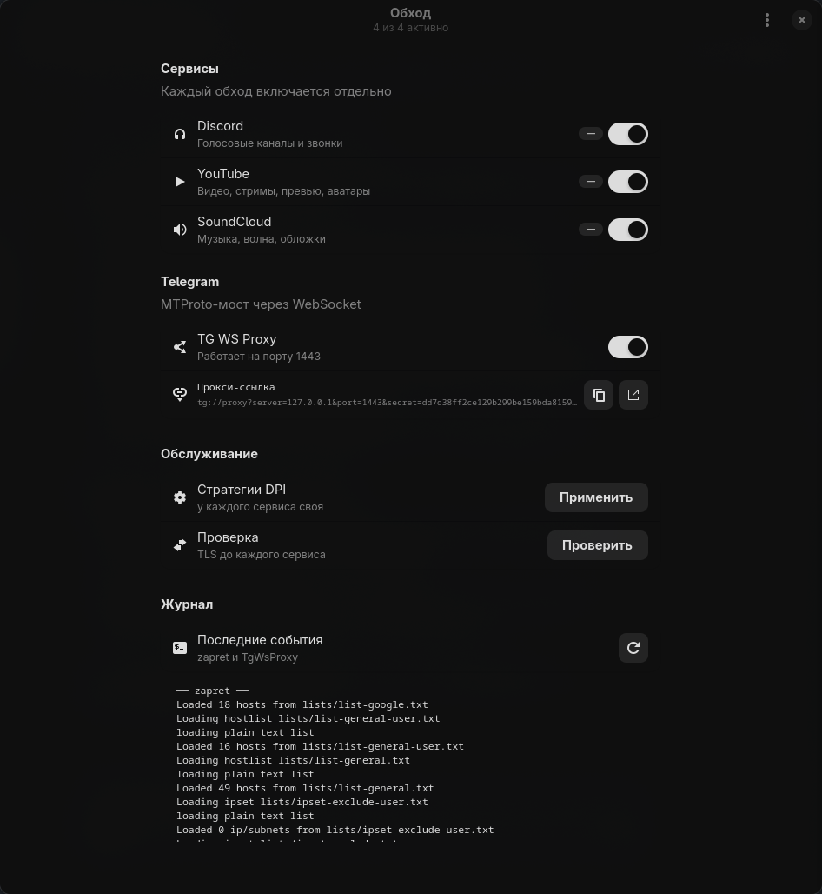

# Обход

Одно окно для обхода блокировок. Каждый сервис включается отдельно:

| Сервис | Что обходит | Движок | DPI-стратегия |
|---|---|---|---|
| **Discord** | голос, звонки, чат | zapret (`nfqws`) | `multisplit`, `split-pos=1` |
| **YouTube** | видео, стримы, превью, аватары | zapret | `multidisorder`, `split-pos=midsld` |
| **SoundCloud** | музыка, волна, обложки | zapret | `multidisorder`, `split-pos=midsld` |
| **Telegram** | MTProto через WebSocket | TgWsProxy | — |

Интерфейс чёрно-белый (GTK4 + libadwaita), без цветных акцентов.



## Запуск

```bash
python3 ~/obhod/obhod.py
```

Или из меню приложений — ярлык «Обход»
(`~/.local/share/applications/obhod.desktop`).

## Как это работает

### Отдельные тумблеры

Один метод на все сервисы не работает: у голоса Discord и у видео YouTube
разные DPI-фильтры, и то, что пробивает один, ломает другой. Поэтому у
каждого сервиса своя стратегия.

При переключении приложение:

1. пишет в `zapret-latest/obhod.bat` правила **только для включённых**
   сервисов;
2. синхронизирует `lists/list-general-user.txt` (включённые домены) и
   `lists/list-exclude-user.txt` (выключенные);
3. перезапускает службу `zapret_discord_youtube.service`.

### Почему такие стратегии

* **Discord.** Голос идёт на `c-<регион><хеш>.discord.media` по портам
  2053/2083/2087/2096/8443. DPI рвёт TLS по имени `discord.media` —
  снаружи это выглядит как вечное «Подключение». Пробивает разбиение
  первого пакета: `--dpi-desync=multisplit --dpi-desync-split-pos=1`.
* **YouTube.** Сама страница и API пробиваются `multidisorder midsld`.
  Видео идёт с `rr*---sn-*.googlevideo.com`; для него важно, чтобы
  `googlevideo.com` попадал в UDP-правило (`fake` + QUIC) и в TCP-правило.
* **SoundCloud.** Обложки лежат на `i1.sndcdn.com` и режутся отдельно от
  сайта. Тот же `multidisorder midsld` открывает и сайт, и CDN, и «Волну».

### Проверка

Кнопка «Проверить» делает реальный TLS-хендшейк до каждого сервиса:

* Discord — берёт **актуальный** голосовой сервер из лога клиента
  (`~/.config/discord/logs/renderer_js.log`);
* YouTube — `www.youtube.com` + аватары `yt3.ggpht.com`;
* SoundCloud — `soundcloud.com` + обложки `i1.sndcdn.com`.

Пилюля `✓` — сервис и картинки доступны, `обложки ✗` — сайт открывается,
но CDN режется.

## Управление без пароля

По умолчанию переключение тумблера вызывает запрос пароля (polkit).
Один раз нажмите меню → **«Разрешить управление без пароля»** — правило
разрешит только `start/stop/restart` службы zapret, и дальше тумблеры
работают молча.

Правило: `/etc/polkit-1/rules.d/49-obhod.rules`.

## Требования

- `python-gobject`, `gtk4`, `libadwaita`
- `curl` для проверок
- `polkit`-агент (`polkit-gnome` уже запущен)
- zapret: `~/zapret-discord-youtube-linux`
- TgWsProxy: `/usr/local/bin/TgWsProxy`

## Если что-то сломалось

- **После обновления репозитория zapret** стратегия могла перезаписаться —
  меню → «Применить настройки» (или кнопка «Применить» в блоке
  «Обслуживание»).
- **Видео YouTube не играет** — проверьте, что YouTube включён и служба
  активна; после смены стратегии страницу нужно перезагрузить
  (Ctrl+Shift+R).
- **Служба не перезапускается** — нет правила polkit: меню →
  «Разрешить управление без пароля».

## Мелочи

Чтобы окно не тайлилось в Hyprland:

```
windowrulev2 = float,class:^(io.github.obhod.Obhod)$
windowrulev2 = size 620 820,class:^(io.github.obhod.Obhod)$
```

## Удаление

```bash
rm -rf ~/obhod ~/.local/share/applications/obhod.desktop
sudo rm -f /etc/polkit-1/rules.d/49-obhod.rules
```

Настройки zapret и TgWsProxy не трогаются.
